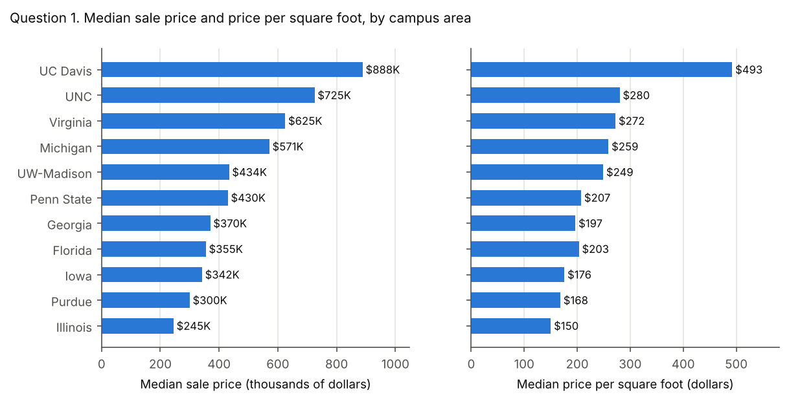
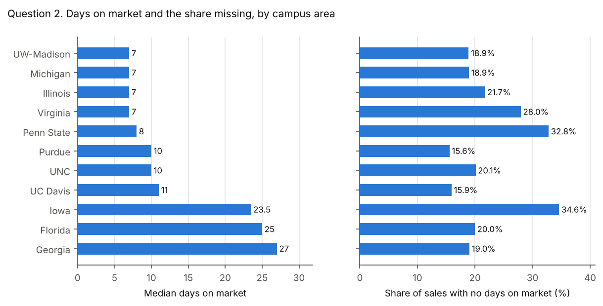
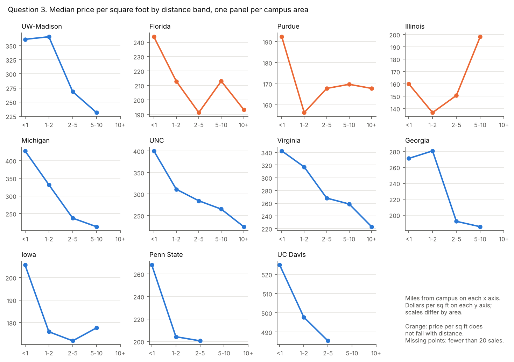
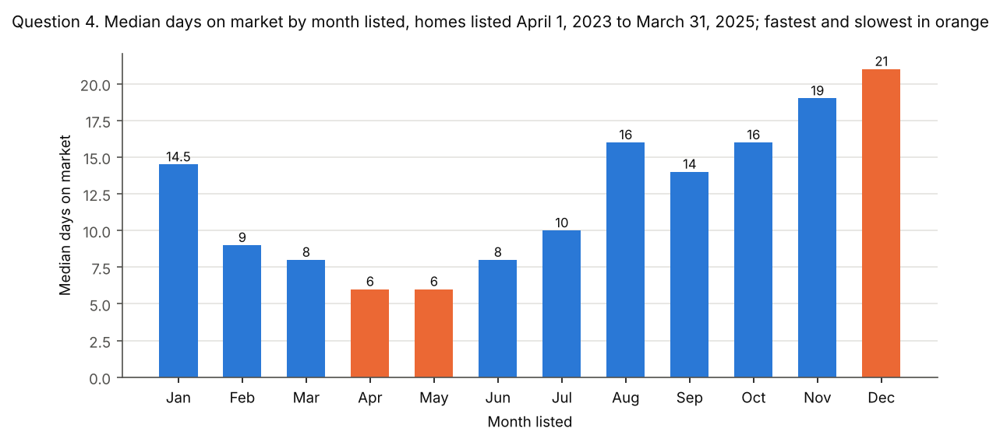
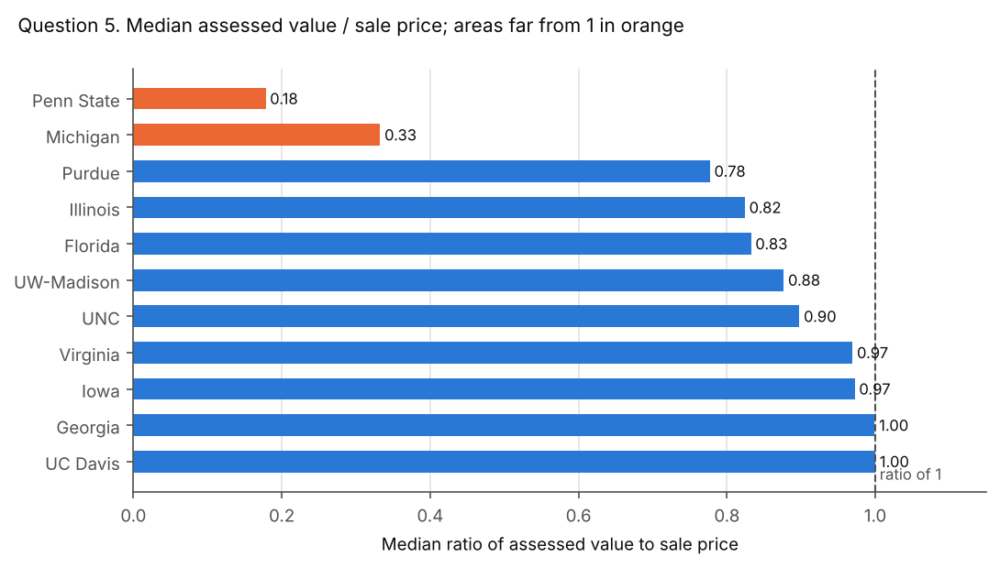
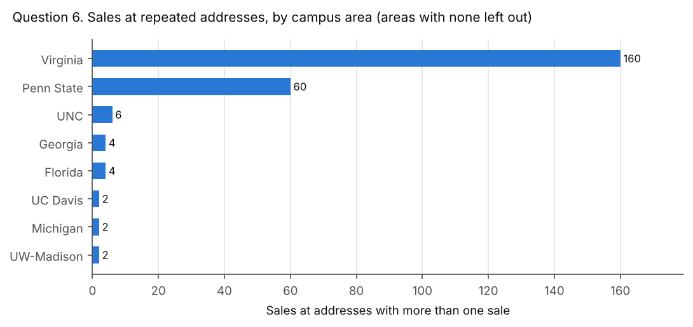

# Variation 2 Answer Key

This key gives the answer to each of the six Variation 2 questions, as computed by the reference code. For each question it shows the figures, a chart, a model answer, the common wrong answers with the figures they produce, and the tolerance for marking. The workbook `Variation 2 Answer Key.xlsx` holds the same figures.

The case's definitions apply throughout: a valid sale is $1,000 or more; price per square foot is computed per valid sale with at least 100 sq ft, then the median is taken; days on market runs from `list_date` to `contract_date`; groups under 20 sales show "fewer than 20 sales"; medians, not means.

Mark an answer correct when it is within the tolerance stated for its question. The tolerances allow for rounding but not for a different definition: each common wrong answer below falls outside them.

To regenerate every number here, run `python run_all.py` in `instructor/reference-code`.

<!-- pagebreak -->

## Question 1. Price levels

> For each campus area, what are the median sale price and the median price per square foot? Which areas are highest and lowest on each measure? Does the ranking change between the two measures, and why might it?

### Figures

**Price levels by campus area**

| Campus area | Valid sales | Median sale price | Rank | Sales with price per sq ft | Median price per sq ft | Rank |
|---|---:|---:|---:|---:|---:|---:|
| University of California, Davis | 942 | $888,500 | 1 | 942 | $492.58 | 1 |
| The University of North Carolina at Chapel Hill | 3,018 | $725,000 | 2 | 3,007 | $280.25 | 2 |
| University of Virginia | 2,853 | $625,000 | 3 | 2,851 | $272.35 | 3 |
| University of Michigan | 3,021 | $571,000 | 4 | 3,011 | $259.07 | 4 |
| University of Wisconsin-Madison | 5,707 | $434,020 | 5 | 5,706 | $249.16 | 5 |
| The Pennsylvania State University | 1,350 | $430,000 | 6 | 1,345 | $207.42 | 6 |
| University of Georgia | 2,815 | $370,000 | 7 | 2,363 | $196.82 | 8 |
| University of Florida | 5,630 | $355,000 | 8 | 5,624 | $203.24 | 7 |
| The University of Iowa | 1,909 | $342,000 | 9 | 1,907 | $175.91 | 9 |
| Purdue University | 4,616 | $299,900 | 10 | 4,615 | $168.24 | 10 |
| University of Illinois Urbana-Champaign | 3,664 | $245,000 | 11 | 3,650 | $150.30 | 11 |

### Chart

### Model answer

UC Davis is highest on both measures, with a median sale price of $888,500 and $492.58 per square foot. Illinois is lowest on both, at $245,000 and $150.30.

The ranking barely changes. Only Georgia and Florida trade places, at 7 and 8. Georgia homes sell for more ($370,000 against $355,000), but they are larger (median 1,902 sq ft against 1,756), so they cost less per square foot. Price per square foot adjusts for size; median price does not.

### Common wrong answers

**Mean instead of median.** Means are pulled up by a few very expensive sales, up to $81,510,000.

| Campus area | correct: median of valid sales | mean instead of median |
|---|---:|---:|
| Purdue University | $299,900 | $328,005 |
| The Pennsylvania State University | $430,000 | $473,855 |
| The University of Iowa | $342,000 | $389,734 |
| The University of North Carolina at Chapel Hill | $725,000 | $825,203 |
| University of California, Davis | $888,500 | $976,367 |
| University of Florida | $355,000 | $405,906 |
| University of Georgia | $370,000 | $491,409 |
| University of Illinois Urbana-Champaign | $245,000 | $277,416 |
| University of Michigan | $571,000 | $657,369 |
| University of Virginia | $625,000 | $797,754 |
| University of Wisconsin-Madison | $434,020 | $503,439 |

**Ratio of medians, mean of ratios, or blank areas divided.** Price per square foot is a median of per-sale values. Dividing the median price by the median area, averaging, or letting a blank or 0 sq ft area divide (JavaScript returns Infinity) each gives a different figure.

| Campus area | correct: median of per-sale values | median price / median living area | mean of per-sale values | no area floor, blank or 0 sq ft divided as 0 |
|---|---:|---:|---:|---:|
| Purdue University | $168.24 | $164.42 | $166.68 | $168.25 |
| The Pennsylvania State University | $207.42 | $202.45 | $217.25 | $208.15 |
| The University of Iowa | $175.91 | $168.14 | $182.41 | $175.93 |
| The University of North Carolina at Chapel Hill | $280.25 | $277.67 | $299.76 | $280.43 |
| University of California, Davis | $492.58 | $482.75 | $500.31 | $492.58 |
| University of Florida | $203.24 | $202.16 | $210.27 | $203.32 |
| University of Georgia | $196.82 | $198.76 | $220.92 | $209.30 |
| University of Illinois Urbana-Champaign | $150.30 | $147.59 | $151.44 | $150.55 |
| University of Michigan | $259.07 | $256.98 | $281.39 | $259.22 |
| University of Virginia | $272.35 | $260.53 | $300.23 | $272.37 |
| University of Wisconsin-Madison | $249.16 | $243.28 | $267.47 | $249.16 |

### Tolerance

- Median sale price: within $1,000 of the key. Rounding to the nearest thousand is fine.
- Median price per sq ft: within $1.00.
- Ranking: the site must name UC Davis highest and Illinois lowest on both measures, and notice that Georgia and Florida swap. Any reason based on home size earns full credit.

<!-- pagebreak -->

## Question 2. Speed

> For each campus area, what is the median days on market? What share of sales has no days on market because a date is missing? Which areas sell fastest, and how could the missing share affect the comparison?

### Figures

**Days on market by campus area**

| Campus area | Sales | Sales with days on market | Median days on market | Share with no days on market |
|---|---:|---:|---:|---:|
| University of Wisconsin-Madison | 5,707 | 4,628 | 7 | 18.9% |
| University of Michigan | 3,022 | 2,450 | 7 | 18.9% |
| University of Illinois Urbana-Champaign | 3,664 | 2,868 | 7 | 21.7% |
| University of Virginia | 2,854 | 2,056 | 7 | 28.0% |
| The Pennsylvania State University | 1,351 | 908 | 8 | 32.8% |
| Purdue University | 4,616 | 3,897 | 10 | 15.6% |
| The University of North Carolina at Chapel Hill | 3,018 | 2,411 | 10 | 20.1% |
| University of California, Davis | 942 | 792 | 11 | 15.9% |
| The University of Iowa | 1,909 | 1,248 | 23.5 | 34.6% |
| University of Florida | 5,630 | 4,505 | 25 | 20.0% |
| University of Georgia | 2,816 | 2,280 | 27 | 19.0% |

### Chart

### Model answer

Four areas tie as the fastest, at a median of 7 days: Illinois, Michigan, UW-Madison and Virginia. The slowest are Georgia (27), Florida (25) and Iowa (23.5).

Between 15.6% (Purdue) and 34.6% (Iowa) of sales have no days on market. Those sales are mostly off-market and new construction sales, so they are not a random sample. The medians describe only homes that were listed, and areas with a large missing share, such as Iowa and Penn State, are the least comparable.

### Common wrong answers

**Measured to sale_date, blanks as zero, or a mean.** Days on market ends at `contract_date`. Using `sale_date` adds the time to close. Treating a blank date as 0 makes unlisted homes look instant. A mean is pulled up by homes that took over a year.

| Campus area | correct: list_date to contract_date | measured to sale_date | blanks treated as zero | mean instead of median |
|---|---:|---:|---:|---:|
| Purdue University | 10 | 45 | 5 | 27.8 |
| The Pennsylvania State University | 8 | 53 | 4 | 29.3 |
| The University of Iowa | 23.5 | 62 | 3 | 41.6 |
| The University of North Carolina at Chapel Hill | 10 | 50 | 6 | 34.5 |
| University of California, Davis | 11 | 38 | 8 | 29.5 |
| University of Florida | 25 | 67 | 13 | 52.8 |
| University of Georgia | 27 | 56 | 16 | 52.1 |
| University of Illinois Urbana-Champaign | 7 | 52 | 5 | 27.7 |
| University of Michigan | 7 | 39 | 5 | 25.4 |
| University of Virginia | 7 | 57 | 5 | 29.4 |
| University of Wisconsin-Madison | 7 | 44 | 6 | 21.6 |

**Missing share counts only list_date.** A sale needs both dates. Counting only a missing `list_date` misses sales with a list date but no contract date.

| Campus area | correct: missing either date | counting only a missing list_date |
|---|---:|---:|
| Purdue University | 15.6% | 6.2% |
| The Pennsylvania State University | 32.8% | 31.8% |
| The University of Iowa | 34.6% | 9.4% |
| The University of North Carolina at Chapel Hill | 20.1% | 19.6% |
| University of California, Davis | 15.9% | 15.4% |
| University of Florida | 20.0% | 18.6% |
| University of Georgia | 19.0% | 16.2% |
| University of Illinois Urbana-Champaign | 21.7% | 20.9% |
| University of Michigan | 18.9% | 17.1% |
| University of Virginia | 28.0% | 27.4% |
| University of Wisconsin-Madison | 18.9% | 18.6% |

### Tolerance

- Median days on market: within 0.5 days. For Iowa, 23.5 and 24 are both correct.
- Share with no days on market: within 0.5 percentage points.
- The comment on the missing share should say the missing sales are not random, or that the comparison covers listed homes only.

<!-- pagebreak -->

## Question 3. Distance

> For each campus area, what is the median price per square foot in each distance band? In most areas, does price per square foot fall as the distance from campus grows? Name any area where it does not.

### Figures

**Median price per sq ft by distance band**

| Campus area | Under 1 mile | 1 to under 2 miles | 2 to under 5 miles | 5 to under 10 miles | 10 miles or more |
|---|---:|---:|---:|---:|---:|
| University of Wisconsin-Madison | $361.21 | $365.72 | $268.46 | $231.40 | fewer than 20 sales |
| University of Florida | $243.72 | $212.90 | $191.27 | $213.03 | $193.37 |
| Purdue University | $192.34 | $156.25 | $167.76 | $169.70 | $167.77 |
| University of Illinois Urbana-Champaign | $159.98 | $136.70 | $150.59 | $198.20 | no sales |
| University of Michigan | $427.52 | $331.77 | $237.26 | $212.99 | fewer than 20 sales |
| The University of North Carolina at Chapel Hill | $400.20 | $311.09 | $284.47 | $265.15 | $224.32 |
| University of Virginia | $342.35 | $317.04 | $268.06 | $258.75 | $223.04 |
| University of Georgia | $271.19 | $280.68 | $192.20 | $185.46 | no sales |
| The University of Iowa | $205.59 | $175.98 | $171.94 | $177.70 | no sales |
| The Pennsylvania State University | $268.06 | $204.25 | $200.60 | no sales | no sales |
| University of California, Davis | $524.89 | $497.78 | $485.47 | fewer than 20 sales | no sales |

**Sales in each cell**

| Campus area | Under 1 mile | 1 to under 2 miles | 2 to under 5 miles | 5 to under 10 miles | 10 miles or more |
|---|---:|---:|---:|---:|---:|
| University of Wisconsin-Madison | 85 | 286 | 2,589 | 2,744 | 2 |
| University of Florida | 136 | 471 | 2,711 | 2,273 | 33 |
| Purdue University | 102 | 339 | 2,715 | 1,393 | 66 |
| University of Illinois Urbana-Champaign | 132 | 751 | 2,554 | 213 | 0 |
| University of Michigan | 179 | 791 | 1,624 | 414 | 3 |
| The University of North Carolina at Chapel Hill | 128 | 420 | 1,413 | 959 | 87 |
| University of Virginia | 154 | 466 | 1,262 | 912 | 57 |
| University of Georgia | 84 | 354 | 1,350 | 575 | 0 |
| The University of Iowa | 171 | 635 | 1,072 | 29 | 0 |
| The Pennsylvania State University | 218 | 363 | 764 | 0 | 0 |
| University of California, Davis | 76 | 358 | 500 | 8 | 0 |

**Pattern by area**

| Campus area | Pattern | Highest band | Largest rise between neighboring bands |
|---|---|---|---:|
| University of Wisconsin-Madison | falls overall | 1 to under 2 miles | 1.2% |
| University of Florida | does not fall | Under 1 mile | 11.4% |
| Purdue University | does not fall | Under 1 mile | 7.4% |
| University of Illinois Urbana-Champaign | does not fall | 5 to under 10 miles | 31.6% |
| University of Michigan | falls at every step | Under 1 mile | 0.0% |
| The University of North Carolina at Chapel Hill | falls at every step | Under 1 mile | 0.0% |
| University of Virginia | falls at every step | Under 1 mile | 0.0% |
| University of Georgia | falls overall | 1 to under 2 miles | 3.5% |
| The University of Iowa | falls overall | Under 1 mile | 3.3% |
| The Pennsylvania State University | falls at every step | Under 1 mile | 0.0% |
| University of California, Davis | falls at every step | Under 1 mile | 0.0% |

A rise of 0.0% means price per square foot never rises from one band to the next.

### Chart

### Model answer

Yes, in most areas. Price per square foot is highest within 1 mile of campus in 8 of 11 areas, and it falls with distance in 8: at every step in Michigan, Penn State, UC Davis, UNC and Virginia, and overall, with no rise between neighboring bands above 5.0%, in Georgia, Iowa and UW-Madison.

It does not fall in Florida, Illinois and Purdue. Illinois is the clearest exception: its highest band is 5 to under 10 miles ($198.20, against $159.98 under 1 mile).

Nine of the 55 cells have fewer than 20 sales, all in the outer bands, and show "fewer than 20 sales" or no sales.

### Common wrong answers

**All areas pooled into one line.** Pooling mixes areas with different price levels. The outer bands are dominated by a few areas, so the pooled line rises again even though most areas fall.

| Band | Sales | Median price per sq ft |
|---|---:|---:|
| Under 1 mile | 1,465 | $281.40 |
| 1 to under 2 miles | 5,234 | $238.33 |
| 2 to under 5 miles | 18,554 | $201.56 |
| 5 to under 10 miles | 9,520 | $217.65 |
| 10 miles or more | 248 | $207.65 |

**Small cells shown.** These medians rest on fewer than 20 sales and must be replaced by "fewer than 20 sales".

| Campus area | Band | Sales | Median shown in error |
|---|---|---:|---:|
| University of California, Davis | 5 to under 10 miles | 8 | $610.78 |
| University of Michigan | 10 miles or more | 3 | $143.38 |
| University of Wisconsin-Madison | 10 miles or more | 2 | $206.18 |

### Tolerance

- Each reportable cell: within $1.00.
- Every cell with 1 to 19 sales shows "fewer than 20 sales". A cell with no sales may show that, a dash or "no sales".
- The answer says yes for most areas and names Illinois. Naming Florida and Purdue as well is correct. Naming an area that falls at every step (Michigan, Penn State, UC Davis, UNC and Virginia) is wrong.

<!-- pagebreak -->

## Question 4. Timing

> Across all areas, what is the median days on market for each calendar month in which homes were listed? Use only homes listed from April 1, 2023 through March 31, 2025, so that each calendar month covers exactly two years. Group them by the month of `list_date`. Which months are fastest, and which are slowest?

### Figures

**Days on market by month listed, homes listed April 1, 2023 to March 31, 2025**

| Month listed | Listings with days on market | Median days on market |
|---|---:|---:|
| January | 1,196 | 14.5 |
| February | 1,511 | 9 |
| March | 1,990 | 8 |
| April | 2,041 | 6 |
| May | 2,131 | 6 |
| June | 1,992 | 8 |
| July | 1,584 | 10 |
| August | 1,489 | 16 |
| September | 1,494 | 14 |
| October | 1,442 | 16 |
| November | 1,035 | 19 |
| December | 653 | 21 |

### Chart

### Model answer

Homes listed in April and May go under contract fastest, at a median of 6 days. December listings are slowest (21 days), followed by November (19).

Spring listings sell fastest and late-year listings slowest, the usual pattern of a spring buying season.

### Common wrong answers

**No window, wrong month or wrong end date.** Listings outside the window are incomplete. Grouping by the month of `sale_date` describes when homes closed, not when they were listed. Measuring to `sale_date` adds the time to close. Treating blank dates as 0 pulls every month down.

| Month | correct: listed April 2023 to March 2025 | all years combined (no window) | month of sale_date instead of list_date | measured to sale_date | blanks treated as zero |
|---|---:|---:|---:|---:|---:|
| January | 14.5 | 12 | 31 | 51 | 12.5 |
| February | 9 | 8 | 15.5 | 48 | 8 |
| March | 8 | 7 | 9.5 | 50 | 7 |
| April | 6 | 7 | 7 | 46 | 6 |
| May | 6 | 7 | 7 | 44 | 6 |
| June | 8 | 10 | 6 | 46 | 8 |
| July | 10 | 13 | 7 | 46 | 8 |
| August | 16 | 18 | 8 | 55 | 14 |
| September | 14 | 17 | 12 | 53 | 14 |
| October | 16 | 17 | 14 | 52 | 14 |
| November | 19 | 20 | 14 | 57 | 18 |
| December | 21 | 25 | 20 | 62 | 20 |

### Tolerance

- Each month: within 0.5 days.
- Fastest: April and May. Slowest: December. Naming November as the second slowest is good but not required.

<!-- pagebreak -->

## Question 5. Assessment

> For each campus area, what is the median ratio of `tax_assessed_value` to `sale_price`, for valid sales with an assessed value above 0? Which areas are far from 1, and what could explain the gap?

### Figures

**Median assessed value / sale price**

| Campus area | State | Sales used | Median ratio |
|---|---|---:|---:|
| The Pennsylvania State University | PA | 1,339 | 0.18 |
| University of Michigan | MI | 2,996 | 0.33 |
| Purdue University | IN | 4,360 | 0.78 |
| University of Illinois Urbana-Champaign | IL | 3,581 | 0.82 |
| University of Florida | FL | 5,498 | 0.83 |
| University of Wisconsin-Madison | WI | 5,665 | 0.88 |
| The University of North Carolina at Chapel Hill | NC | 2,858 | 0.90 |
| University of Virginia | VA | 2,661 | 0.97 |
| The University of Iowa | IA | 1,884 | 0.97 |
| University of Georgia | GA | 2,728 | 1.00 |
| University of California, Davis | CA | 927 | 1.00 |

### Chart

### Model answer

Two areas are far from 1: Penn State (0.18) and Michigan (0.33). The other 9 areas run from 0.78 to 1.00, with UC Davis at 1.00.

**Penn State (Pennsylvania).** Pennsylvania counties assess against a "base year" and reassess at irregular intervals (Babst Calland, 2023). The state measures how far assessments have drifted with a common level ratio for each county. For Centre County, the July 2026 factor is 6.10, and the factor is the reciprocal of the ratio, so assessments sit at about one sixth of market value (Pennsylvania Department of Revenue). That matches the data's 0.18.

**Michigan.** Michigan's constitution caps assessed value at 50 percent of true cash value. Taxable value can rise each year only by inflation or 5 percent, whichever is less, until the home sells (Michigan State Tax Commission). Assessments at half of value would give about 0.5. The data's 0.33 is lower still, which fits a field holding the capped taxable value, or assessments that lag rising prices. The dataset does not say which.

**For contrast, UC Davis (California).** California reassesses a home at its purchase price when it changes hands, and the value can then rise by at most 2 percent a year (California State Board of Equalization). A recent sale resets the assessment to about the sale price, so the median ratio is 1.00.

Do not read a state's statutory assessment level into this column. Illinois, for example, sits at 0.82 here. The values are as the collection source reported them.

Sources, checked October 11, 2026:

- [Pennsylvania tax assessment appeals and common level ratios](https://www.babstcalland.com/news-article/pennsylvania-tax-assessment-appeals-and-common-level-ratios-four-observations/) (Babst Calland, October 6, 2023)
- [2025 Common Level Ratio Real Estate Valuation Factors](https://www.pa.gov/content/dam/copapwp-pagov/en/revenue/documents/taxtypes/rtt/documents/clr_factor_current.pdf) (Pennsylvania Department of Revenue, July 2026)
- [Guide to Basic Assessing](https://www.michigan.gov/-/media/Project/Websites/treasury/Assessors/Guide_to_Basic_Assessing_116.pdf) (Michigan State Tax Commission, May 2018)
- [Assessors' Handbook Section 401, Change in Ownership](https://www.boe.ca.gov/proptaxes/pdf/ah401.pdf) (California State Board of Equalization, reprinted January 2015)

### Common wrong answers

**Mean, ratio of medians, inverted ratio, or invalid sales kept.** The ratio is computed per sale, then the median is taken. Including sales under $1,000 divides by tiny prices and wrecks a mean.

| Campus area | correct: median of per-sale ratios | mean of per-sale ratios | median assessed value / median sale price | ratio inverted (sale price / assessed value) | mean including sales under $1,000 |
|---|---:|---:|---:|---:|---:|
| Purdue University | 0.78 | 0.89 | 0.76 | 1.29 | 0.89 |
| The Pennsylvania State University | 0.18 | 0.25 | 0.19 | 5.61 | 0.40 |
| The University of Iowa | 0.97 | 0.97 | 0.94 | 1.03 | 0.97 |
| The University of North Carolina at Chapel Hill | 0.90 | 1.25 | 0.82 | 1.11 | 1.25 |
| University of California, Davis | 1.00 | 0.88 | 0.90 | 1.00 | 0.88 |
| University of Florida | 0.83 | 0.91 | 0.82 | 1.20 | 0.91 |
| University of Georgia | 1.00 | 1.34 | 0.98 | 1.00 | 2.36 |
| University of Illinois Urbana-Champaign | 0.82 | 0.84 | 0.79 | 1.21 | 0.84 |
| University of Michigan | 0.33 | 0.80 | 0.35 | 3.01 | 135.74 |
| University of Virginia | 0.97 | 0.99 | 0.95 | 1.03 | 0.99 |
| University of Wisconsin-Madison | 0.88 | 0.86 | 0.87 | 1.14 | 0.86 |

### Tolerance

- Each median ratio: within 0.01.
- Names Penn State and Michigan as far from 1. Naming UC Davis as far from 1 is wrong.
- The explanation must rest on how each state assesses property, with a source. A claim that homes there sell far above their value earns no credit.

<!-- pagebreak -->

## Question 6. Buildings

> Group sales by street address, city, state and ZIP code. In each campus area, how many addresses have more than one sale, and how many sales do they cover? How does the median `miles_to_campus` of those sales compare with that of all other sales?

### Figures

**Addresses with more than one sale**

| Campus area | Addresses | Sales at those addresses | Median miles, those sales | Median miles, all other sales |
|---|---:|---:|---:|---:|
| University of Virginia | 80 | 160 | 6.7 | 3.3 |
| The Pennsylvania State University | 13 | 60 | 0.5 | 2.2 |
| The University of North Carolina at Chapel Hill | 3 | 6 | fewer than 20 sales | 3.8 |
| University of Georgia | 2 | 4 | fewer than 20 sales | 3.7 |
| University of Florida | 2 | 4 | fewer than 20 sales | 4.4 |
| University of California, Davis | 1 | 2 | fewer than 20 sales | 2 |
| University of Michigan | 1 | 2 | fewer than 20 sales | 2.7 |
| University of Wisconsin-Madison | 1 | 2 | fewer than 20 sales | 4.8 |
| Purdue University | 0 | 0 | no sales | 3.8 |
| The University of Iowa | 0 | 0 | no sales | 2.2 |
| University of Illinois Urbana-Champaign | 0 | 0 | no sales | 2.8 |
| All campus areas | 103 | 240 | 4.1 | 3.4 |

### Chart

### Model answer

In all, 103 addresses have more than one sale, covering 240 sales. They are concentrated in two areas: Virginia (80 addresses, 160 sales) and Penn State (13 addresses, 60 sales). Purdue, Iowa and Illinois have none, and every other area has 3 or fewer such addresses.

Across all areas, those sales sit a median 4.1 miles from campus, against 3.4 for all other sales. That overall figure mixes two opposite patterns. Around Penn State, the repeated addresses are close to campus (0.5 miles against 2.2). Around Virginia, they are farther out (6.7 against 3.3). The other areas have fewer than 20 such sales.

**Instructor note: what the repeated addresses are.** The description sheet calls all 240 rows separate condo or apartment units. That holds in State College. But 87 of the 103 addresses (174 rows) meet the build notes' own test for one sale recorded twice: two rows, prices within 1% and sale dates within 90 days. Of these, 79 are in Virginia, and 78 of those are homes built in 2023 or later. In 79 of the 87 pairs, one row carries the listing dates and the other carries the county's parcel number and assessed value, so the build's parcel check missed them. Their coordinates differ too, which is why Virginia's repeated-address sales look far from campus. Do not mark down a student who spots this and explains it. The figures above follow the question's definition, which counts every row.

### Common wrong answers

**Grouped by street name only, or duplicates removed first.** Grouping by street name alone merges same-named streets in different towns. Removing duplicate addresses first leaves nothing to count. Counting only the extra sales (sales minus addresses) understates the total.

| Method | Addresses | Sales | Median miles of those sales |
|---|---:|---:|---:|
| correct | 103 | 240 | 4.1 |
| grouped by street name only | 139 | 312 | 4.1 |
| after removing duplicate addresses | 0 | 0 | none |
| extra sales only | 103 | 137 | 4.1 |

### Tolerance

- Counts: exact. 103 addresses and 240 sales in total, and each area's counts as in the table. For areas with fewer than 20 such sales, showing the count or "fewer than 20 sales" are both correct.
- Median miles: within 0.05 miles. In areas with fewer than 20 such sales, the median must show "fewer than 20 sales".
- Full credit needs the overall comparison and the observation that it differs by area.
